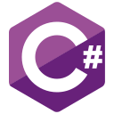

# Project Catalog

An index of projects organized by programming language.

##  Python

Web Development

Data Science

AI

<blockquote>

Machine Learning

Deep Learning

Reinforcement Learning

Computer Vision

<a href="https://github.com/lendoo73/python-for-computer-vision-with-opencv-and-deep-learning">Python for Computer Vision with OpenCV and Deep Learning</a> &mdash; Course materials for OpenCV and deep learning. <a href="https://www.udemy.com/course/python-for-computer-vision-with-opencv-and-deep-learning/">Official course</a>.

<a href="https://github.com/lendoo73/passenger-counter">Passenger Counter</a> &mdash; Counts passengers in bus footage using a trained YOLO model.

<a href="https://github.com/lendoo73/deep-learning-recognition-using-yolov8-complete-project">Deep Learning Recognition Using YOLOv8</a> &mdash; Complete YOLOv8 deep learning recognition project.

<a href="https://github.com/lendoo73/YOLOv26_GPU_Mode">YOLOv26 GPU Mode</a> &mdash; All YOLO26 models (detection, segmentation and more) running in GPU mode.

Timeseries Forecasting

<a href="https://git.icomera.com/LB6306/internet-usage">Internet Usage</a> (private) &mdash; Internet usage forecasting project.

Natural Language Processing

Generative AI

</blockquote>

Automation and Scripting

APIs and Backend

<a href="https://github.com/lendoo73/ml-api">ML API</a> &mdash; FastAPI back-end serving machine learning models (detection, segmentation, classification, pose estimation and more). Uses the models trained in <a href="https://github.com/lendoo73/YOLOv26_GPU_Mode">YOLOv26 GPU Mode</a>. Front-end: <a href="https://github.com/lendoo73/ml-react">ML React</a>.

Desktop Applications

Games

##  JavaScript

Web Development

<a href="https://github.com/lendoo73/ml-react">ML React</a> &mdash; React front-end for the <a href="https://github.com/lendoo73/ml-api">ML API</a> back-end.

##  C#

##  Java

Language icons are from [Devicon](https://devicon.dev/) and are distributed under the [MIT License](icons/LICENSE).
